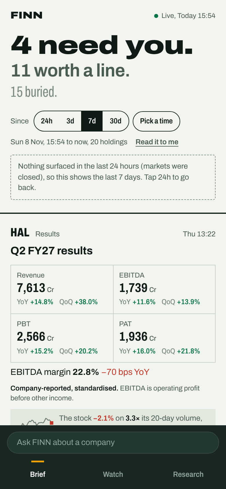
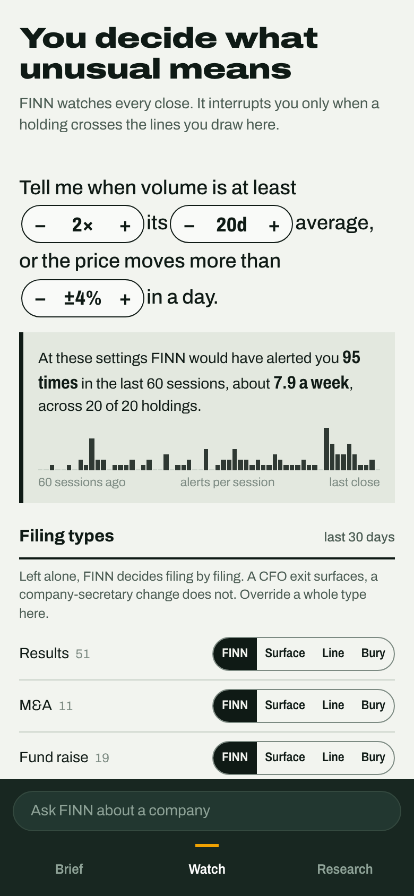
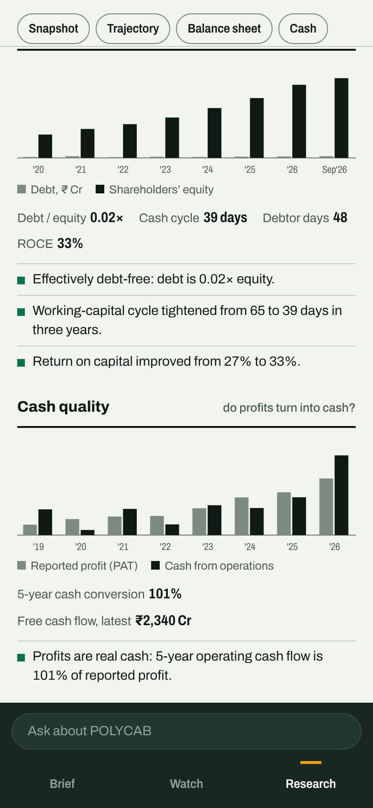

# FINN

A mobile-first financial investment agent for a 20-stock Indian portfolio. It **pushes** what changed and whether it matters, and on **pull** it reads a company's own annual report and earnings calls and holds management to what they said.

| Brief (push) | Watch (your thresholds) | Research (pull) |
|---|---|---|
|  |  |  |

## The point of view

**An inbox with a spine, not a feed and not a chatbot.**

1. **Three depths, always counted.** The home screen is one sentence: *7 need you. 11 worth a line. 86 buried.* The page is a cross-section: bright surface, a darker shelf, a dark bed where routine filings settle. Buried filings are counted and one tap away, because you only trust a filter when you can see what it removed.
2. **One event, one card.** A results day is six filings (board outcome, results, press release, deck, call recording, newspaper ad). FINN folds them into one card with the four headline numbers. A QIP is a thread of committee meetings and allotments: one card, latest status on top. A price move on results day sits inside the results card, not next to it.
3. **You decide what "unusual" means, by its consequence.** The Watch screen is a sentence with steppers: *tell me when volume is at least 2× its 20-day average, or the price moves more than ±4%.* Under it FINN back-tests the setting on your own portfolio: *that would have interrupted you 95 times in the last 60 sessions.* A threshold chosen by how often it fires, not by guessing.
4. **Pull starts from push.** Every surfaced card has "Dig into X" and "Ask", and the question box already knows which company and which event you came from. Typed or spoken; the brief can also be read aloud.
5. **Promised vs delivered, with the arithmetic done by code.** The research view opens on a ledger: what management guided on each call, what the reported numbers then showed, and a verdict. Where the promise was a number on a measurable metric, the verdict is computed, not generated, and is labelled *Checked by arithmetic*.
6. **Every claim links to its page.** Guidance quotes deep-link to `transcript.pdf#page=7`.

## What a model is and is not used for

| Tier | Used for | Cost |
|---|---|---|
| **0. Rules and arithmetic** | Classifying filings (17 categories, ~45 ordered rules), folding events, QoQ/YoY first cut, volume/price signals and back-test, 10-year trajectory, balance-sheet and cash-quality flags, grading numeric guidance | none |
| **1. Flash-Lite class** | Reading one document into structured notes: a concall transcript, a management-change filing, a results PDF (cross-check), the 12 best pages of an annual report | cheap, bulk |
| **2. Flash class** | One call per company: reconcile five calls of notes with the numbers table, write bull/bear | rare |

On the real 30-day feed for this portfolio (271 filings, recorded 15 Nov 2026) the rules placed **all 271** with no model call: 29 surfaced cards, 75 one-liners, 86 buried, 81 folded into other cards. A model is asked to classify only what falls through the last rule, in one batched request.

Other cost decisions:

- **Nothing in the bed is ever read by a model.** Enrichment runs for what surfaces; the middle tier is read when you tap it.
- **PDF text is extracted locally** (`unpdf`), per page, so the model gets text with page markers instead of a PDF, and citations come for free.
- **Annual reports are never sent whole.** Pages are scored against weighted terms locally and the top 12 of ~300 are sent. No embeddings, no vector store: an annual report has headings.
- **Map then reduce.** Each transcript becomes ~1k tokens of notes once, cached forever (a filed PDF never changes). The reasoning call sees ~5k tokens of notes plus a numbers table, not 80k tokens of transcripts. Follow-up questions are answered from the same notes.
- **Model IDs are discovered**, not hard-coded: FINN asks the API for the newest stable Flash and Flash-Lite. Gemini first (a whole transcript fits its context on the free tier), Groq as a fallback for short prompts.
- A cost line is printed under every dossier and at the end of every ingest.

## Architecture

```
            Yahoo chart API      BSE announcements API      screener.in
            (EOD price/volume)   (filings + PDF links)      (reported financials, AR + concall links)
                    \                    |                        /
                     +------------ src/lib/sources ---------------+        data/harvest  (recorded replay)
                                         |
        src/lib/brain   classify -> foldEvents -> signals -> results first cut -> enrich (model, on demand)
        src/lib/research   facts (arithmetic) -> read (map, cheap model) -> synth (code ledger + one strong call)
        src/lib/llm/router   tiers, discovery, pacing, fallback, cache, cost meter
                                         |
         scripts/ingest.ts  ---->  public/snapshot/*.json   (committed; refreshed by `npm run ingest` or the GitHub Action)
                                         |
         Next.js route handlers (live, Mumbai region)  +  static snapshot  ---->  one client app, three tabs
```

- **Snapshot first, live on top.** The client renders the committed snapshot immediately (a static file, cannot fail), then replaces it source by source as the live API answers. If an exchange refuses the host's IP, the app still shows real data and says it is a snapshot.
- **Research is driven by the client, one document per request.** Nothing outlives a serverless timeout, and the progress trace on screen is real.
- **Generalises to any NSE ticker.** Nothing about the portfolio is hard-coded beyond `data/portfolio.json`; BSE scrip codes, statement type (consolidated or standalone) and lender detection are resolved from the company page.
- **Primary sources only on the pull side.** Reported financials plus the company's own annual report and transcripts. screener.in's commentary (About, Pros/Cons, AI summaries) is deliberately not parsed. Web search is used in exactly one place, on the push side: a two-line background for an incoming executive when the filing carries no profile.

## Run it

```bash
npm install
cp .env.example .env.local      # add a free Gemini key (optional, see below)
npm run ingest                  # builds public/snapshot from live sources (5-8 min with a key)
npm run dev                     # http://localhost:3000, open on a phone or a narrow window
npm test                        # 24 tests
```

- **No key:** everything in tier 0 works. Results cards, signals, triage, the numeric research.
- **With `GEMINI_API_KEY`** (free, [aistudio.google.com/apikey](https://aistudio.google.com/apikey)): filings are read, and research produces the ledger, guidance and bull/bear.
- `npm run replay` rebuilds the snapshot from `data/harvest` with no network at all.
- `npm run ingest -- --only DIXON,TRENT` researches specific tickers; `--no-research`, `--days 45`, `--no-llm` also exist.

**Deploy:** import the repo in Vercel, set `GEMINI_API_KEY`, deploy. `vercel.json` pins functions to Mumbai. Add the same key as a GitHub Actions secret to run the `Refresh snapshot` workflow, which rebuilds and commits the snapshot. Any source that fails during an ingest keeps its last saved data, so a bad network day never empties the snapshot.

## What is verified, and what is not

- **Verified on real data:** all three sources were recorded from the live sites on 15 Nov 2026 (24 companies, 384 filings, 127 sessions each) and the full pipeline runs on them: parsing, triage, folding, results first cuts for 18 companies, signals, back-test, research arithmetic. The UI was checked at 390 px against that data.
- **Verified with a scripted model:** routing, model discovery, quota fallback, caching, cost metering, and the read → code-ledger → synthesis pipeline (`tests/llm.test.ts`).
- **Not yet verified here:** real model output quality and server-side fetching from a cloud host, because the build environment had no outbound access to the model API or the exchanges. `npm run ingest` with a key is the test; its log (`ingest.log`) shows each step.

## Decisions and trade-offs

- **BSE, not NSE, for filings.** Same disclosures, a far more dependable endpoint. NSE's API sits behind cookie and bot checks that fail from cloud IPs.
- **Rules before models for classification.** Subject lines come from an exchange dropdown, so rules are free, instant and auditable. The cost is maintenance; the rule list was rewritten once against the real feed, and the things it got wrong at first are now tests (a transcript's headline also says "financial results"; debentures are filed as "Allotment" like shares).
- **Results first cut uses the standardised table, cross-checked against the filing** when a key is present. The table is exact and consistent across companies; the PDF read is the fallback when the table has not caught up, and a second opinion otherwise. Lenders get net interest income in place of EBITDA.
- **LinkedIn is linked, not scraped.** SEBI requires a brief profile in appointment filings, so the background comes from the filing itself.
- **No auth, no database.** Settings live on the phone. The snapshot is the database.

## Deliberately left out

Real push notifications (the triage and thresholds are built; delivery via web-push or Telegram is the next step), intraday data, a portfolio editor UI, NSE as a second filings source, charts beyond what the argument needs, and a vector store.

## Where next

1. Delivery: web-push and a Telegram bot that sends only tier-1 cards.
2. Learn the routing: each "Bury this type" and "Move up" is a labelled example; fit per-user rules from them.
3. Promise ledger across years, with a say-do score per management team, comparable across holdings.
4. Segment-level numbers from results PDFs (XBRL) so guidance on segments can be graded by code too.
5. Portfolio-level questions ("which holdings missed margin guidance this quarter?") over the saved notes.

## Layout

```
src/lib/sources     yahoo, bse, screener, pdf, offline replay
src/lib/brain       classify (rules + folding), signals, results, enrich
src/lib/research    facts, read, synth
src/lib/llm         router
src/app/api         brief, enrich, research/[symbol]{,/read,/synth}, ask, search, status
src/components      App, Brief, Watch, Research, Ask, ui
scripts/ingest.ts   snapshot builder        tests/   core + llm        data/   portfolio.json, harvest/
```
